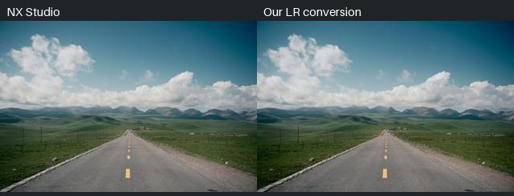

# Nikon Recipes to LR Profiles

[中文](docs/zh/README.md) · [日本語](docs/ja/README.md)

Bring Nikon Imaging Cloud recipe color styles into Lightroom and Adobe Camera Raw, with an **Amount slider from 0 to 200%**. Keep exposure, white balance and other edits available in your normal RAW workflow.

The initial pack contains **236 Nikon recipe conversions** as enhanced-profile `.xmp` files built on Adobe Standard. No separate DCP or installer is needed. These are calibrated approximations, not Nikon's renderer and not a direct NP3 slider translation. **Nikon Z 8 is the tested camera.** Other bodies are unvalidated.

## Use a profile

1. Download and unzip the profiles asset from [Releases](https://github.com/b-z/Nikon-Recipes-to-LR-Profiles/releases).
2. In Lightroom / Camera Raw, open the Profile Browser and choose **Import Profiles**. Select the `.xmp` files. Restart Lightroom if new profiles do not appear.
3. Open **Nikon Recipes LR 0.1**, select a look and adjust **Amount**. Start around 30–50% for a subtle effect; continue editing exposure and white balance normally.

Profiles have new names and UUIDs so they can coexist with previous private test versions.

## Compare the recipes

[Recipe catalog and scores](docs/RECIPES.md) · [Live interactive gallery](https://nikon-recipes-to-lr-profiles.pages.dev/) · [Website build](website/README.md) · [Machine-readable metrics](docs/recipe_metrics.json)

Each recipe has chart fitting errors, a global tetrahedral-face banding-risk score, author/source attribution and previews of four Z8 photographs. The sidebar shows all recipes on Landscape test 1, followed by two landscapes and two banding test scenes. Source documentation keeps only a small example and compact contact sheets. The complete image library is external to Git; website source and asset metadata live in `website/`. Gallery conversions are **numerical RGBTable previews on Camera Raw Adobe Standard exports** unless explicitly labeled as a Camera Raw render. All 944 owner-exported NX Studio references (236 recipes on four scenes) and [compact NX/LR contact sheets](docs/comparisons/README.md) are available on the website. The gallery defaults to NX Studio versus our LR conversion; either side can independently select Adobe Standard, NX or our conversion. See [gallery workflow](docs/GALLERY.md), [measurement definitions](docs/en/metrics.md) and [actual Camera Raw checks](docs/en/acr-validation.md).

**Banding is a known issue.** Low chart ΔE does not guarantee smooth skies or bokeh. The pack includes 19 YC7 profiles plus 217 YC4 profiles; 18 YC7 looks passed the owner's recent Lightroom review, while Bleach Blue still showed residual banding. The remaining 217 have not all passed that review. This is deliberately visible in the catalog. The four new sample scenes are not a blanket pass/fail certification.

## Calibrate another recipe

```sh
python -m venv .venv
. .venv/bin/activate  # Windows: .venv\Scripts\activate
python -m pip install --upgrade pip
python -m pip install -e .
nikon-recipes-lr fit --adobe-samples adobe.json --nx-samples nx.json   --name "My recipe" --author "Recipe author" --output my-recipe.xmp   --report my-recipe-report.json
nikon-recipes-lr audit my-recipe.xmp
```

New recipes need matched NX Studio and Adobe chart renders. The NP3 reader supplies metadata; it does not replace those renders. [Calibration guide](docs/en/calibration.md) covers target generation, NX batch sidecars, 16-bit TIFF sampling, fitting and optional macOS Photoshop automation. Core Python math works without Nikon or Adobe applications; rendering requires applications you install separately.

Get original NP3 files from their creators / Nikon Imaging Cloud or the external [Nikon-Recipes archive](https://github.com/shouryan01/Nikon-Recipes). Original NP3 files, Adobe base profiles and vendor SDK code are not bundled.

## Scope and licenses

Tool code and original documentation: [MIT](LICENSE). Generated conversion resources: [profile resource notice](PROFILE_LICENSE.md). Four sample RAWs and all previews derived from them: **project testing and comparison only**, with [separate photo terms](samples/LICENSE.md); other uses require permission. Untouched original RAW copies, published with the owner's permission, are provided as a separate sample asset to keep normal clones small.

Color and global tone are in scope. Sharpening, clarity, grain, lens-correction extraction, Fuji film simulation conversion, spatial/local adjustments and guaranteed Nikon parity are outside the first release. The output is an editing base, not a promise of a finished JPEG match at every edit setting.

## Contribute / support

Issues and pull requests are welcome: camera calibration, smoothness improvements, reproducible regressions, tests and English/Chinese/Japanese documentation. See [CONTRIBUTING](CONTRIBUTING.md).

[GitHub Sponsors — b-z](https://github.com/sponsors/b-z) (availability depends on the owner's Sponsors activation).

Independent community project; not affiliated with or endorsed by Nikon or Adobe. Original recipe authors are credited in the catalog and profile metadata.

A small Filmic example (NX Studio on the left, our conversion on the right):



For all scenes and recipes, use the [online gallery](https://nikon-recipes-to-lr-profiles.pages.dev/).
