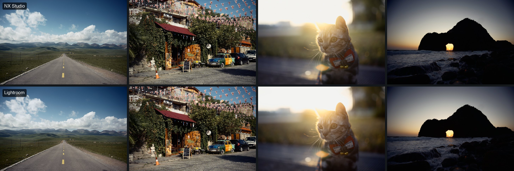

# NRLR - Nikon Recipes to LR Profiles

[](https://github.com/b-z/Nikon-Recipes-to-LR-Profiles/releases/latest) [](https://github.com/sponsors/b-z)

[English](../../README.md) · [日本語](../ja/README.md)

### 👉 [打开在线对比图库](https://nikon-recipes-to-lr-profiles.pages.dev/)：236 款配方与 NX Studio 逐一对比，喜欢哪款就单独下载哪款

[尼康云创](https://imagingcloud.nikon.com/)（Nikon Imaging Cloud）汇集了许多专业摄影师创作的色彩配方。不过，这些配方只作用于相机直出的 JPEG，不会改变 RAW 图像。如果你需要处理 RAW 文件，想在后期用上这些配方，就只能使用尼康官方的 NX Studio，而这与很多摄影师的工作流并不兼容。

本项目在 **Lightroom 和 Photoshop Camera Raw** 中复刻了这些配方。在「配置文件」里选择配方，用「数量」滑块调整强度（0–200%）即可；曝光、白平衡、曲线等调整依然照常可用。当前版本包含 **236 款配方**，经实测，大部分都能很好地还原原版配方的色彩。

[](https://nikon-recipes-to-lr-profiles.pages.dev/#KG200P1)

*KG200P1 配方在四张测试照片上的效果。上排为 NX Studio，下排为 Lightroom 中数量 100% 的配置文件。[在图库中可以这样对比每一款配方](https://nikon-recipes-to-lr-profiles.pages.dev/)。*

## 相比官方云创的优势

- **强度可调。**「数量」滑块从 0 到 200%；NX Studio 中的官方预设只能使用固定强度。
- **支持官方配方不支持的相机。**云创配方只能用在具备 Flexible Color 优化校准的较新尼康机身上，旧机型即使在 NX Studio 里也无法套用。我们的版本适用于 Lightroom 能打开的任何 RAW：旧款尼康，甚至其他品牌的相机。
- **实测而非目测，完全开源。**每款配方都公布与 NX Studio 的色差和断层风险，图库在四张照片上逐一对比；转换你自己配方的工具也在本仓库中。

## 安装

1. 从[最新 Release](https://github.com/b-z/Nikon-Recipes-to-LR-Profiles/releases/latest) 下载与你相机对应的压缩包并解压：有「相机 Flexible Color」的尼康机身选 `…-z8`、`-z9`、`-zf`、`-z6iii`、`-z5ii`、`-z50ii` 或 `-zr`，其他相机选 `…-adobe`。
2. 在 Lightroom 或 Camera Raw 的配置文件浏览器中选择「导入配置文件」，选中 `.xmp` 文件。如果没有出现，重启 Lightroom。
3. 打开名称以 **NRLR Y9**（机型版）或 **NRLR Y8**（Adobe 通用版）开头的分组，选择配方并调整强度（「数量」滑块）；100% 为原版配方色彩；30–50% 效果较温和。

各机型的压缩包以「相机 Flexible Color」为基础，最接近 NX Studio；Adobe 通用版以 Adobe Standard 为基础，适用于任何相机。各机型压缩包的色彩表都在该机型上测量。详见[安装说明](INSTALL.md)。

## 配置文件包含什么

配置文件复刻的是配方的**色彩和影调**：NX Studio 渲染出的色彩、对比度和色调曲线、饱和度以及色彩分级。配方中的**锐化、中等锐化和清晰度不包含在内**，这些细节设置会被忽略；锐化、纹理、清晰度、降噪、颗粒、暗角和镜头校正仍按你自己的 Lightroom 设置。

## 按拍摄时的配方自动套用

相机会把拍摄时使用的配方名称记录在每个 NEF 里。本项目的命令行工具可以读出这个名称，并在每个 RAW 旁边写一个附属文件（sidecar），让 Lightroom Classic 和 Camera Raw 打开照片时直接套用对应的配置文件：

```sh
nikon-recipes-lr sidecars --profiles /path/to/nikon-recipes-lr-profiles-1.2.0-z8/profiles /path/to/photos
```

请在导入照片之前运行。安装方法和细节见[自动套用配置文件](auto-apply.md)。

## 对比各款配方

- **[在线对比图库](https://nikon-recipes-to-lr-profiles.pages.dev/)**：每款配方在四张照片上的效果，NX Studio 与 Lightroom 配置文件可以闪烁对比，附两项评分，每款都能单独下载。
- **[配方目录](../RECIPES.md)**：每个配置文件的作者、与 NX Studio 的色差和断层风险分（[分数说明](metrics.md)）。

## 原理

### 测量配方

我们以 NX Studio 为基准，因为它就是尼康自己把配方应用到 RAW 文件上的方式。对每款配方，NX Studio 渲染一张合成测试色卡：这是一个包含 24,720 个色块的 Z 8 RAW 文件，覆盖从暗到亮、从中性到高饱和、各个色相的颜色。Camera Raw 再用基础配置文件、不套配方渲染同一张色卡。每个色块因此给出一对颜色：Lightroom 的起点，以及配方把它变成的颜色。我们不逐项翻译配方参数，因为尼康的曲线、色彩混合器和色彩分级与 Lightroom 的滑块所在的色彩空间和处理顺序都不同；配置文件跟随的是 NX Studio 实际输出的结果。

### 拟合平滑的颜色映射

根据这 24,720 对颜色，我们拟合出一个把任意 Lightroom 颜色映射到配方颜色的函数。Lightroom 的颜色表每个轴上有 32 个点，共约 3.3 万个点、每点三个数值，点与点之间按直线插值。如果每个点都自由拟合，颜色表就会跟着每个色块的微小测量噪声走，在相邻的格子之间弯折得各不相同。在照片里，这些弯折会出现在颜色缓慢变化的地方，比如天空、皮肤和焦外背景，变成看得见的台阶（断层）。本项目早期版本就出现过这种情况。

从 0.2 起，映射是一个**平滑的三次样条**：每个轴 16 个控制点，并对曲率加以惩罚。它的一阶和二阶导数处处连续，所以渐变保持平滑；系数有上下界，所以输出始终在色彩空间之内、不会被截断。32³ 的颜色表再从这个平滑函数上采样得到。代价是在色卡上的差异略大一些；1.0 与 NX Studio 的色差中位数仍约为 0.5 ΔE，低于多数人能察觉的程度。[方法说明（英文）](../Y8_REBUILD.md)。

### 存成 Lightroom 配置文件

每款配方对应一个 Adobe **增强型配置文件**：一个小小的 `.xmp` 文件，Lightroom Classic、Lightroom 和 Camera Raw 都能直接导入，Adobe 自己的创意配置文件用的也是这种格式。其中关键的字段是：

- `crs:PresetType="Look"`：表示这是叠加在基础配置文件之上的配置文件。
- `crs:CameraProfile`：基础配置文件，各机型的压缩包为 `Camera Flexible Color`，Adobe 通用版为 `Adobe Standard`。Camera Raw 先用它渲染 RAW。
- `crs:RGBTable` 和 `crs:Table_<ID>`：32×32×32 的颜色表。表中的 16 位数值以相对「不改变」的偏移量存储，压缩后写成文本；ID 是这张表的校验值。Camera Raw 在基础配置文件之后把它应用到每个像素上。
- `crs:SupportsAmount="True"`，加上表头中 200% 的上限：配置文件因此有了**数量**滑块，在基础配置文件（0%）和完整配方（100%）乃至更强之间混合。
- `crs:CameraModelRestriction`（例如 `Nikon Z f`）、`crs:Group`、`crs:Name` 和 `crs:UUID`：决定配置文件在哪里、以什么名称出现。每个版本都使用新的 UUID，不同版本之间不会互相覆盖。

在 Lightroom 中，只有配置文件能容纳完整的三维颜色表。修改预设只能设置 HSL、曲线等滑块，表达不了配方对每一种颜色的改变，还会覆盖你自己的滑块设置；相机配置文件（DCP）则必须为每台相机单独制作，也没有数量滑块。用增强型配置文件，配方就是配置文件浏览器里的一个选项，强度可调，其他滑块仍完全由你掌握。

### 为什么用「相机 Flexible Color」

0.2 及以前的配置文件以 Adobe Standard 为基础。Camera Raw 会根据每张照片最暗的像素调低 Adobe Standard 的黑电平，因此在没有纯黑的日光场景里，阴影会比 NX Studio 更暗、颜色更深。「相机 Flexible Color」是 Adobe 对尼康 Flexible Color 优化校准（云创配方正是以它为基础）的匹配，它保留传感器的黑电平。换用它之后，1.0 在色卡上 236 款全部比 0.2 更接近 NX Studio，实拍照片的阴影也明显更接近 NX Studio，其中 235 款的断层风险分也更低。[详细说明（英文）](../Y9_FLEX_BASE.md)。

Adobe 的所有相机匹配配置文件（相机标准、相机中性等）都保留传感器的黑电平，用哪一个都能解决阴影问题。选「相机 Flexible Color」，是因为它正是配方的起点：云创配方是在尼康 Flexible Color 优化校准的基础上制作的。从 Adobe 对它的匹配出发，颜色表只需要描述配方本身的改动，这是最小、因此也最平滑的修正。Adobe 为每台具备 Flexible Color 的尼康机身（Z 8、Z 9、Z f、Z6III、Z5II、Z50II、ZR）分别制作了「相机 Flexible Color」。它的亮度并不是在每台机身上都与 NX Studio 完全一致，所以从 1.1 起，每台机身的颜色表都用该机身自己的 RAW 数据制作的色卡拟合，方法和色块与 Z 8 相同。[详细说明](../Y9_FLEX_BASE.md#one-table-per-camera)（英文）。

## 转换你自己的配方

自己创建的优化校准，或者不在本版本中的配方，也可以自行转换。仓库中附带 [Z 8 校准包](../../calibration/z8/)，包含色卡、NX Studio 设置和 Camera Raw 测量数据；有 NX Studio 和 Python 就能在几分钟内转换一款配方。见[转换你自己的配方](convert-your-own-recipe.md)。

## 已知限制

- **色彩断层。** 平滑的天空和焦外仍可能出现台阶，数量越高越明显。发现问题欢迎附上配方名和一小块裁切[反馈](https://github.com/b-z/Nikon-Recipes-to-LR-Profiles/issues/new/choose)。
- **近似。** 236 款中有 223 款与 NX Studio 的平均色卡色差低于 1 ΔE（CIEDE2000，约为人眼刚能察觉的差异），最大为 1.44 ΔE。个别颜色和照片的差异可能更大。

## 参与贡献

欢迎贡献其他尼康机身的校准、可复现的断层反馈、更好的拟合方法、测试、文档和翻译。请先阅读[贡献指南](CONTRIBUTING.md)，所有参与者都应遵守[行为准则](../../CODE_OF_CONDUCT.md)。各版本的变化见 [CHANGELOG](../../CHANGELOG.md)。

## 支持这个项目

这个项目是在业余时间维护的。如果这些配置文件对你有帮助，欢迎通过 [GitHub Sponsors](https://github.com/sponsors/b-z) 或微信赞赏支持。赞助完全自愿，不会影响 Issue 和 Pull Request 的处理。

<table><tr>
<td align="center" valign="middle"><a href="https://github.com/sponsors/b-z"></a></td>
<td align="center" valign="middle"></td>
</tr></table>

## 署名与许可

- 配方归各自的作者所有，每个配置文件、配方目录和[在线图库](https://nikon-recipes-to-lr-profiles.pages.dev/)中都有署名。本项目不分发原始 NP3 文件，请从作者、尼康云创或 [Nikon-Recipes 合集](https://github.com/shouryan01/Nikon-Recipes)获取。
- 代码与文档采用 [MIT](../../LICENSE) 许可；生成的配置文件采用 MIT 并附[署名说明](../../PROFILE_LICENSE.md)。第三方说明见 [THIRD_PARTY_NOTICES](../../THIRD_PARTY_NOTICES.md)。
- 四张样本照片、校准色卡（其内嵌预览图来自其中一张）及由它们生成的图像**不适用** MIT，仅可用于本项目的测试和对比，见[照片条款](../../samples/LICENSE.md)。

本项目为独立的社区项目，与尼康、Adobe 无关联，也未获其认可。
